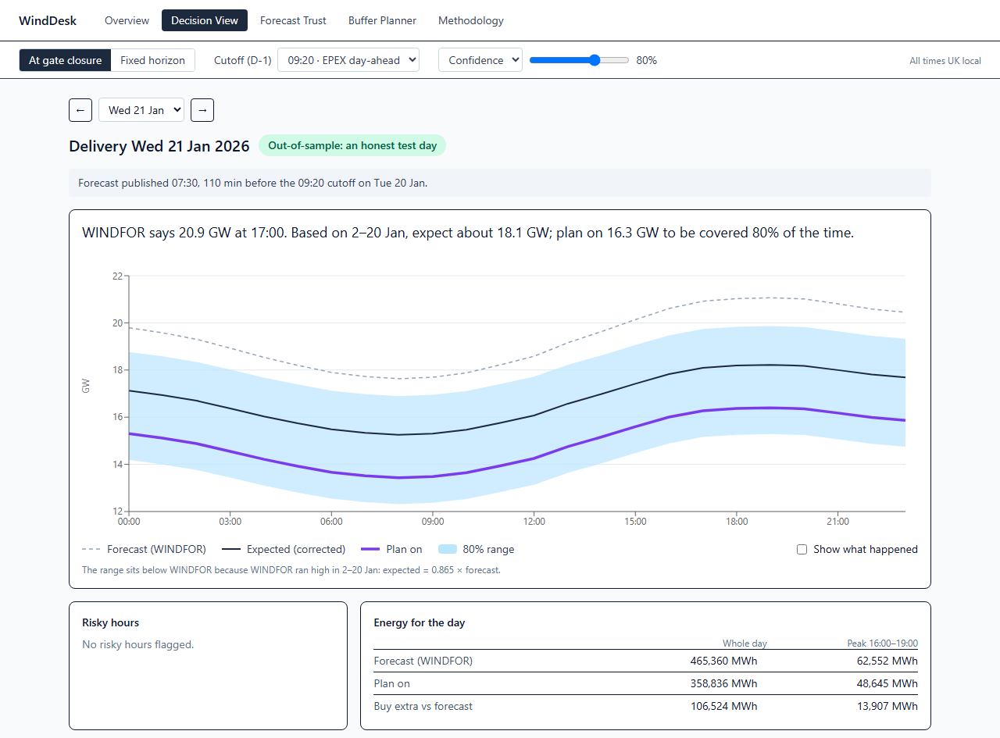

# WindDesk

A day-ahead planning aid for a UK wind trading desk. For each delivery day it shows the national wind forecast the trader actually had at the 09:20 gate (Elexon WINDFOR), how wrong that forecast has been against metered wind (Elexon FUELHH), and how much wind to plan on for a chosen confidence. The data covers decisions made in January 2026 (delivery 2 Jan – 1 Feb), and nothing on screen uses information published after the gate. In January the forecast the trader had at 09:20 ran **1.7 GW too high on average**. Planning at the 20th percentile would have left the desk short in **22%** of the 288 test hours, against **287 of 288** for trusting WINDFOR.

**Live app:** https://nqghdt.vercel.app (API docs: https://nqghdt.vercel.app/docs)
**Video:** _link to be added_



## Reviewer's 5-minute tour

Open these in order. Each one is short, and together they cover the whole idea.

1. [`backend/app/core/selection.py`](backend/app/core/selection.py) (lines 17–42) and its test [`backend/tests/test_selection.py`](backend/tests/test_selection.py) (lines 24–50). This is the rule everything rests on: for each hour, the latest forecast published **at or before** the D-1 cutoff. The test pins the boundary: a forecast published at exactly 09:20:00 is used, and one at 09:20:01 is not.
2. [`backend/app/core/correction.py`](backend/app/core/correction.py) (lines 1–60). Four candidate centres fitted only on hours whose actual was known before the first test decision. Proportional (`0.865 × forecast`) won, and the module docstring says why linear lost.
3. [`backend/app/core/bands.py`](backend/app/core/bands.py) (lines 45–122). Empirical bands: the train residuals are kept per wind-level cell, and any quantile is read on demand, so the 80% band and the planner's P20 come from the same data.
4. [`backend/app/api/routes/decision.py`](backend/app/api/routes/decision.py) (the whole file, 57 lines). A thin route: validate, take the cached fit, call the pure functions in `core/decision.py`, and return a pydantic-checked response.
5. [`frontend/src/pages/DecisionView.tsx`](frontend/src/pages/DecisionView.tsx) (lines 24–50 and 137–154). The 09:20 screen. The headline sentence is generated from the API numbers, and actuals stay hidden until "Show what happened" is ticked.

## How to run

**Docker** (the whole app, one container):

```bash
docker compose up --build
```

Then open http://localhost:8080.

**Dev mode without Docker** (Python 3.12, Node 22; two terminals; Vite proxies `/api` to port 8000):

```bash
python -m venv .venv && .venv/Scripts/pip install -r requirements-dev.txt   # .venv/bin on Linux/macOS
cd backend && ../.venv/Scripts/python -m uvicorn app.main:app --reload --port 8000
# second terminal
cd frontend && npm ci && npm run dev        # http://localhost:5173
```

**Checks:** `scripts/check` (bash, from the repo root) runs exactly what CI runs and stops at the first failure: `Dockerfile` vs `Dockerfile.vercel`, ruff lint and format, pytest with coverage, then frontend lint and build. Timing is kept out of CI because it depends on the machine. Run `pytest -m perf` from `backend/` for that check, or `python -m app.report` to print the January summary with warm response times.

**Offline model check** (not part of the app): `pip install -r requirements-offline.txt` (adds scikit-learn), then `python scripts/model_check.py` from the repo root. It prints the gradient-boosting vs proportional comparison for all three cutoffs.

**Refresh the data.** January 2026 is history, so the snapshot in `data/raw/` is committed and the app never calls Elexon at runtime:

```bash
cd backend
python -m app.data.ingest           # fetch from Elexon and overwrite data/raw/
python -m app.data.ingest --check   # cleaning counts and per-day coverage of what is on disk
```

## Deployment

The app runs on **Vercel's Container runtime (beta)**. Vercel builds the root `Dockerfile` as a Container project, and the server listens on `$PORT` (8000). `Dockerfile.vercel` is an identical copy: Vercel's docs say it makes the Container preset win over the frameworks Vercel detects in `backend/` and `frontend/`. CI fails if the two files differ. One image serves both the React build and the FastAPI `/api`, the same as local Docker.

The container scales to zero after about 5 minutes without traffic, so **the first load after an idle spell may take a few seconds**. We measured 3.5 s; later requests are fast.

## Files and directories

```
├── Dockerfile, Dockerfile.vercel  one image: Node builds React, python:3.12-slim serves it + /api
├── docker-compose.yml             one service on http://localhost:8080
├── requirements.txt               runtime deps (requirements-dev.txt adds pytest, ruff, mypy)
├── scripts/check                  CI's steps locally, stops at the first failure
├── .github/workflows/ci.yml       backend: cmp + ruff + pytest; frontend: lint + build
├── data/raw/                      committed January snapshot (116 KB) + manifest.json
├── docs/                          ARCHITECTURE.md, METHODOLOGY.md, AI_USAGE.md, img/
├── backend/
│   ├── pyproject.toml             ruff, pytest (perf marker), coverage, mypy config
│   ├── app/
│   │   ├── main.py                create_app(): load + warm the store, mount /api, serve the React build
│   │   ├── config.py              every tunable: cutoffs, dates, train/test split, cells, thresholds
│   │   ├── schemas.py             pydantic response models (the API contract)
│   │   ├── report.py              python -m app.report: the January numbers + warm timings
│   │   ├── data/
│   │   │   ├── elexon_client.py   one-day chunked GETs, retries with backoff, row validation
│   │   │   ├── ingest.py          CLI: fetch → data/raw/*.csv.gz (deterministic) + --check
│   │   │   ├── loaders.py         read + clean (every dropped row counted) + detect resolution
│   │   │   └── store.py           DataStore: snapshot + LRU caches per mode (selection, fit, calibration)
│   │   ├── core/                  pure pandas functions, no I/O, 100% test coverage
│   │   │   ├── timeutils.py       UK delivery date, DST-safe D-1 cutoff, settlement period
│   │   │   ├── selection.py       latest forecast ≤ cutoff (or ≤ start − h); revisions
│   │   │   ├── alignment.py       hourly actuals, error = actual − forecast, coverage, train/test split
│   │   │   ├── metrics.py         MAE, RMSE, bias, quantiles, breakdowns, worst misses, same-hour comparisons
│   │   │   ├── correction.py      raw / constant / linear / proportional centre, forecast-only input
│   │   │   ├── bands.py           residuals per wind-level cell, bands, coverage + by-day bootstrap
│   │   │   ├── planner.py         newsvendor alpha, planned wind, policy backtest (MWh, £)
│   │   │   └── decision.py        one delivery day: band, plan, flags, freshness, MWh totals
│   │   └── api/
│   │       ├── deps.py            shared params and limits (422), the Store dependency, records()
│   │       └── routes/            meta, decision, accuracy, calibration, planner, timeseries
│   └── tests/                     one test file per core module + data layer + API contract tests
└── frontend/src/
    ├── App.tsx, main.tsx          router, header nav, settings bar, query client
    ├── state/settings.ts          global settings in the URL query string
    ├── api/client.ts, types.ts    typed fetch + one TanStack Query hook per endpoint
    ├── pages/                     Overview, DecisionView, ForecastTrust, BufferPlanner, Methodology
    ├── components/                SettingsBar, KpiTile, ChartCard (chart + table twin), Status, charts/
    └── lib/                       number/date formatting, colours, phone-width hook
```

## Key decisions

- **09:20 cutoff and no look-ahead.** The trader commits at the EPEX day-ahead gate, 09:20 UK time on D-1, so each hour uses the latest forecast published at or before then. The comparison is `≤`, so a forecast published at 09:20:00 counts. 09:50 and 15:30 are presets. Actuals appear only as labelled hindsight. Scoring the last forecast before delivery instead would make WINDFOR look 17% better (MAE 1,687 vs 2,039 MW) than what the trader could act on.
- **Leak-free train/test split.** The correction and the bands are fitted only on hours whose actual was known at the first test decision: 441 hours from 2 Jan 00:00 to 20 Jan 08:00. They are scored on the 288 hours of 21 Jan – 1 Feb. The hours from 20 Jan 09:00 to 23:00 are in neither set.
- **Proportional correction, not linear.** The forecast ran high at every wind level (actual ÷ forecast between 0.82 and 0.94). Linear's intercept (+1,460 MW) raises calm-hour forecasts that were already too high: in the calmest fifth its test bias was −1,300 MW, against −775 MW for proportional. Proportional (`0.865 × forecast`) has the lowest test MAE at all three cutoffs: 1,032 vs 1,153 MW at 09:20. An offline gradient-boosting check ([`scripts/model_check.py`](scripts/model_check.py): same split, same metrics, not part of the app) did worse: 1,531 MW at 09:20, and worse at all three cutoffs and in every by-day bootstrap. Its error sits in the windiest hours, which in training were 44 hours from 4 days, mostly the 12 Jan night of the worst miss. One parameter fitted on all 441 hours generalises better.
- **3-cell empirical bands, checked on unseen days.** The residuals are kept per wind-level cell (edges 8,868 and 13,650 MW, 147 training hours each), and quantiles are read on demand. On the 12 test days the 80% band caught **80%** of hours, with a by-day bootstrap range of 66–92%. A planned split by horizon was dropped because it showed no consistent width difference.
- **No MAPE.** MAPE divides by the actual, so calm hours dominate it, and it treats over- and under-forecasts unequally. The desk pays per MW and MWh, so errors stay in MW: MAE, RMSE, bias and quantiles, each shown with its `n`.
- **Snapshot data.** January 2026 is history, so it was fetched once and committed (116 KB). The app can't break when Elexon is down, every number is reproducible, and tests run on real data.

## Limitations and Phase 2

- **Curtailment vs coverage can't be separated.** The forecast ran high at every level, which is consistent with a scaling or coverage gap between the two datasets, and most of all in the windiest fifth, which is consistent with curtailment. Neither can be confirmed from these two datasets alone. Embedded (distribution-connected) wind is not in either dataset.
- **One winter month.** January's bias and spread may not hold in summer or in a calmer month. A live product would refit on a rolling window.
- **About 31 independent days.** Hours within a day share weather, so the real sample is days, not 744 hours. The test window is 12 days, which is why coverage is shown with a by-day range.
- **Model chosen on the test window.** The proportional centre was picked from 4 candidates by looking at test-window numbers, so those numbers are slightly optimistic.
- **Flat £ prices understate cost**, because imbalance prices tend to spike exactly when wind under-delivers.

**Phase 2:** a live "Tomorrow" page using the same core functions on a rolling fit; demand and solar forecasts; imbalance prices for real £ costs; portfolio-level wind instead of the national total; smooth bands between cells.

## AI tools used

Built with **Claude Code** (Anthropic) in VS Code. The AI wrote most of the code, tests and docs: the scaffold, the Elexon client and ingest, the pure `core/` functions with their tests, the API, the React pages, CI and Docker, and checked the screens with headless-browser screenshots. The author decided the product and the methodology by hand: the users and the decision being supported, the domain rules (09:20 cutoff, `≤` at the gate, error sign, no filling of gaps), the metrics and why not MAPE, the leak-free split, the proportional correction, the band cells, what the Decision View shows, and the deployment path. The author also reviewed each milestone by running the app. The full log, area by area, is in [docs/AI_USAGE.md](docs/AI_USAGE.md).
